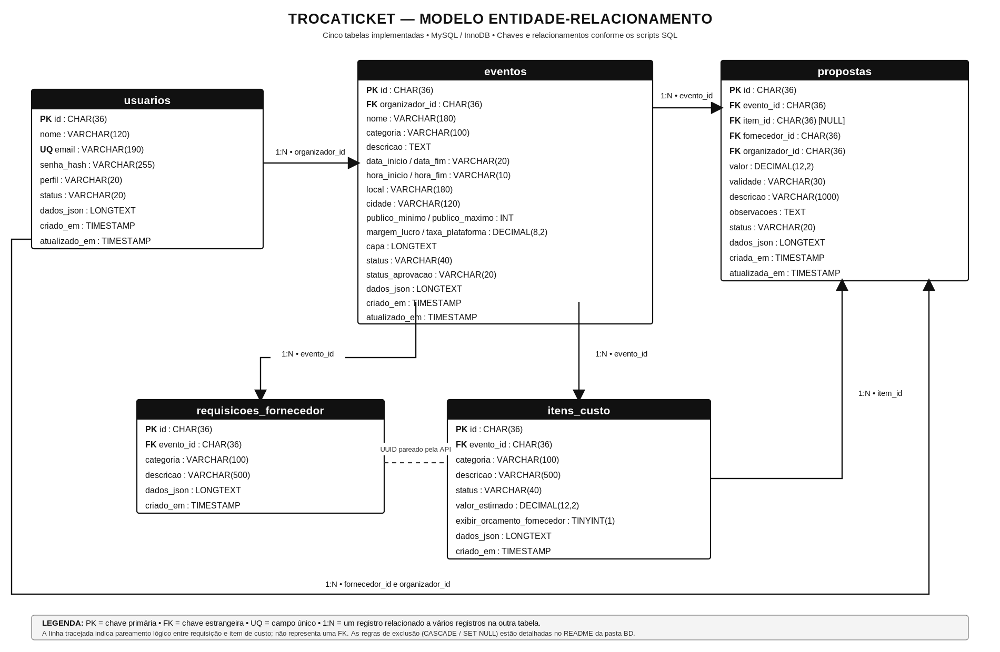

# Banco de Dados — TrocaTicket

## Estrutura, campos e tipos de dados

### Tabela `usuarios`

| Campo | Tipo de dado | Chave |
|---|---|---|
| `id` | `CHAR(36)` | PK |
| `nome` | `VARCHAR(120)` | |
| `email` | `VARCHAR(190)` | |
| `senha_hash` | `VARCHAR(255)` | |
| `perfil` | `VARCHAR(20)` | |
| `status` | `VARCHAR(20)` | |
| `dados_json` | `LONGTEXT` | |
| `criado_em` | `TIMESTAMP` | |
| `atualizado_em` | `TIMESTAMP` | |

### Tabela `eventos`

| Campo | Tipo de dado | Chave |
|---|---|---|
| `id` | `CHAR(36)` | PK |
| `organizador_id` | `CHAR(36)` | FK → `usuarios.id` |
| `nome` | `VARCHAR(180)` | |
| `categoria` | `VARCHAR(100)` | |
| `descricao` | `TEXT` | |
| `data_inicio` | `VARCHAR(20)` | |
| `hora_inicio` | `VARCHAR(10)` | |
| `data_fim` | `VARCHAR(20)` | |
| `hora_fim` | `VARCHAR(10)` | |
| `local` | `VARCHAR(180)` | |
| `cidade` | `VARCHAR(120)` | |
| `publico_minimo` | `INT` | |
| `publico_maximo` | `INT` | |
| `margem_lucro` | `DECIMAL(8,2)` | |
| `taxa_plataforma` | `DECIMAL(8,2)` | |
| `capa` | `LONGTEXT` | |
| `status` | `VARCHAR(40)` | |
| `status_aprovacao` | `VARCHAR(20)` | |
| `dados_json` | `LONGTEXT` | |
| `criado_em` | `TIMESTAMP` | |
| `atualizado_em` | `TIMESTAMP` | |

### Tabela `requisicoes_fornecedor`

| Campo | Tipo de dado | Chave |
|---|---|---|
| `id` | `CHAR(36)` | PK |
| `evento_id` | `CHAR(36)` | FK → `eventos.id` |
| `categoria` | `VARCHAR(100)` | |
| `descricao` | `VARCHAR(500)` | |
| `dados_json` | `LONGTEXT` | |
| `criado_em` | `TIMESTAMP` | |

### Tabela `itens_custo`

| Campo | Tipo de dado | Chave |
|---|---|---|
| `id` | `CHAR(36)` | PK |
| `evento_id` | `CHAR(36)` | FK → `eventos.id` |
| `categoria` | `VARCHAR(100)` | |
| `descricao` | `VARCHAR(500)` | |
| `status` | `VARCHAR(40)` | |
| `valor_estimado` | `DECIMAL(12,2)` | |
| `exibir_orcamento_fornecedor` | `TINYINT(1)` | |
| `dados_json` | `LONGTEXT` | |
| `criado_em` | `TIMESTAMP` | |

### Tabela `propostas`

| Campo | Tipo de dado | Chave |
|---|---|---|
| `id` | `CHAR(36)` | PK |
| `evento_id` | `CHAR(36)` | FK → `eventos.id` |
| `item_id` | `CHAR(36)` | FK → `itens_custo.id` |
| `fornecedor_id` | `CHAR(36)` | FK → `usuarios.id` |
| `organizador_id` | `CHAR(36)` | FK → `usuarios.id` |
| `valor` | `DECIMAL(12,2)` | |
| `validade` | `VARCHAR(30)` | |
| `descricao` | `VARCHAR(1000)` | |
| `observacoes` | `TEXT` | |
| `status` | `VARCHAR(20)` | |
| `dados_json` | `LONGTEXT` | |
| `criada_em` | `TIMESTAMP` | |
| `atualizada_em` | `TIMESTAMP` | |
